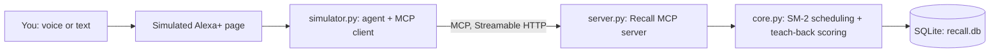

# Recall: a spaced-repetition tutor for Alexa+ (MCP server)

Recall gives a voice assistant a memory it can't fake. You study by talking:
the assistant quizzes you, grades your answers, and asks you to **explain
concepts in your own words** (teach-back). A self-hosted **MCP server** owns the
scheduling, so "what's due tomorrow?" is answered from real data instead of
a guess.

Built for the **Alexa+ track** of the Amazon Developer Hackathon.

The scheduling and teach-back scoring are also published as a standalone library: [recall-engine](https://github.com/vlaksh26/recall-engine).

## Why an MCP server
A chat model can't reliably remember what you studied last Tuesday or when a
card is next due. Recall keeps that state on the server and exposes it as MCP
tools. Every tool returns a short `speech` string (written to be said aloud)
plus structured data.



## What it does
| Tool | Purpose |
|---|---|
| `add_cards` | Add flashcards (question and answer) to a deck |
| `next_due` | Get the next card that is due today |
| `grade_answer` | Record how well you recalled it (`again`, `hard`, `good`, `easy`) and reschedule |
| `add_concept` | Add a concept with key points to explain aloud |
| `teach_back` | Score a spoken explanation against the key points, then reschedule |
| `progress_summary` | Cards due, reviewed today, mastered, and day streak |
| `advance_days` | Demo only (`RECALL_DEBUG=1`): move the clock forward to show scheduling |

Scheduling uses the SM-2 algorithm. Teach-back checks which key points your
explanation covered and turns the coverage into a review rating.

## How it uses the Alexa+ technology
- `server.py` is a self-hosted MCP server over **Streamable HTTP** (endpoint
  `/mcp`), built with the official Python SDK (`mcp` 1.x, `FastMCP`).
- It was checked with MCP Inspector v2.11.0, which negotiated protocol version
  **MCP 2025-11-25**.
- `simulator.py` is an MCP client plus a rule-based agent that stands in for
  Alexa+, so the whole experience can be shown without a device. It prints
  every MCP call and its response time live.
- In the simulator, local tool calls take roughly 10 to 30 ms. A hosted
  deployment has not been measured yet.

## Run it
Requires Python 3.10 or newer.

```
python -m venv .venv
.venv\Scripts\Activate.ps1          # Windows PowerShell
# source .venv/bin/activate         # macOS / Linux
pip install -r requirements.txt
python tests/test_core.py           # should end with: 11 passed
```

Terminal 1, the MCP server (the demo flag enables `advance_days`):
```
$env:RECALL_DEBUG="1"; python server.py      # Windows PowerShell
# RECALL_DEBUG=1 python server.py            # macOS / Linux
```
It listens on `http://127.0.0.1:8787/mcp`.

Terminal 2, the simulated Alexa+ page:
```
python simulator.py
```
Open `http://127.0.0.1:8000` in **Chrome** (voice input needs it). Click
**Load demo deck**, then **Quiz me**, and answer out loud or by typing.

Other ways to try the server:
- `python smoke_test.py` runs a scripted client against the running server.
- Point MCP Inspector (`npx @modelcontextprotocol/inspector`) at
  `http://127.0.0.1:8787/mcp` using the Streamable HTTP transport.

To reset all data, stop the server and delete `recall.db`.

## Project layout
```
core.py          SM-2 scheduling, teach-back scoring, SQLite storage (no MCP code)
server.py        the MCP server
simulator.py     simulated Alexa+: MCP client, rule-based agent, web backend
index.html       the simulator page (voice in and out, live MCP call panel)
smoke_test.py    scripted MCP client for a quick check
tests/           unit tests for the scheduler and teach-back
FRICTION.md      friction log and product feedback
```

## Status and limits
- Built from scratch during the hackathon submission period (started 17 Oct 2026).
- Single user and a local SQLite file. Per-user accounts are the next step before
  a real multi-user deployment.
- The simulator's agent uses simple rules to understand speech. It is a stand-in
  for Alexa+'s own language understanding, not a replacement for it.

## License
MIT. See `LICENSE`.
